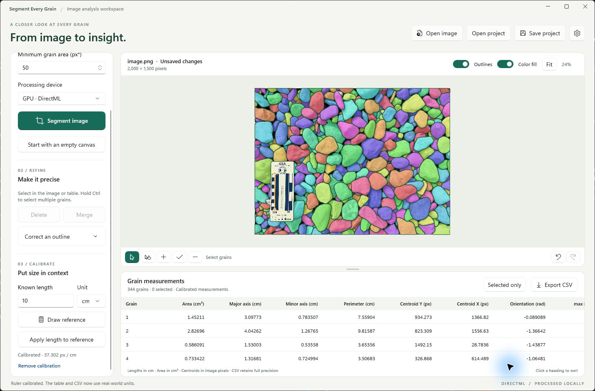

# Segment Every Grain for Windows

A native Windows workspace for finding, correcting, and measuring grains in photographs. Segment an image with U-Net and SAM 2.1, refine individual masks, calibrate against a ruler, and inspect or export the measurements without opening a notebook.

The interface is built with **WinUI 3 and C#**. A separate local **Python/PyTorch** worker runs the segmentation engine, with **DirectML** GPU acceleration or CPU processing.



*The real application after segmentation and calibration. The photograph is the [Barton Creek example](https://github.com/zsylvester/segmenteverygrain/blob/main/examples/barton_creek/barton_creek_image.jpg) from the upstream project. The displayed results illustrate the workflow, not a segmentation-accuracy benchmark.*

## Contents

- [Features](#features)
- [Requirements](#requirements)
- [Download and first-time setup](#download-and-first-time-setup)
- [Tutorial: from photograph to calibrated CSV](#tutorial-from-photograph-to-calibrated-csv)
- [Manual segmentation](#manual-segmentation)
- [Keyboard shortcuts](#keyboard-shortcuts)
- [Exported files and measurement units](#exported-files-and-measurement-units)
- [Updating, backups, and offline use](#updating-backups-and-offline-use)
- [Troubleshooting](#troubleshooting)
- [Build from source](#build-from-source)
- [Tests and validation](#tests-and-validation)
- [Project structure](#project-structure)
- [Credits and licensing](#credits-and-licensing)

## Features

- Automatic grain segmentation with **Detailed / SAM 2.1 Large** and **Fast / SAM 2.1 Tiny** model choices.
- A native canvas with zoom, pan, linked grain selection, and one-click mask creation.
- Foreground/background prompts for correcting difficult boundaries.
- Delete, merge, and session undo/redo for mask edits and calibration changes.
- Independent **Outlines** and **Color fill** switches; colors stay consistent for each grain ID.
- Ruler calibration in millimeters or centimeters.
- A resizable measurements panel with numeric sorting and selected-grain filtering.
- CSV export and saved projects containing the image, outlines, training mask, and calibration.
- A bottom progress bar with stage descriptions, completed work, elapsed time, and measured stage-time estimates.

Processing runs on the local computer. The application does not start a web server or upload images for inference. Internet access is needed for initial dependency/model downloads and for downloading a model that is not already cached.

This desktop application is a separate Windows adaptation of [segmenteverygrain](https://github.com/zsylvester/segmenteverygrain), not an official release of the upstream project.

## Requirements

| Component | Requirement or support status |
| --- | --- |
| Operating system | 64-bit Windows. The current build was validated on Windows 11 x64. The project declares Windows 10 version 1809 as its platform minimum; older Windows configurations have not been validated here. |
| GPU processing | A DirectX 12 GPU compatible with the installed DirectML runtime and driver. AMD Radeon RX 6600 was exercised; other adapters depend on driver and operator support. |
| CPU processing | Available through machine setup and the processing-device selector. CPU inference speed has not been benchmarked for this build. |
| Storage and memory | Space for the private Python environment, packages, model weights, and project images. Large images and the Detailed model need more resources; no universal minimum RAM/VRAM requirement has been established. |
| Internet | Required during first-time setup and for uncached model downloads. Cached-model processing can run offline. |

The release includes the native app's .NET and Windows App SDK runtime files. End users do **not** need Visual Studio, a separate .NET installation, Jupyter, or a system-wide Python installation.

## Download and first-time setup

### 1. Download the application release

Open this repository's **Releases** page and download the Windows application ZIP attached to a release. Extract the entire ZIP to a writable folder.

GitHub's automatically generated **Source code (zip)** is a source checkout, not an installed application. It does not contain the generated `WinUI/` directory or the setup executable.

Keep this layout together:

```text
SegmentEveryGrain-Windows/
├── Segment Every Grain.exe      # Native application launcher
├── Machine Setup.exe            # Python environment and model setup
├── WinUI/                       # Entire published app, not just its EXE
│   ├── SegmentEveryGrain.exe
│   ├── SegmentEveryGrain.pri
│   ├── Backend/
│   └── ...                      # DLLs, XAML resources, assets, runtime files
├── README.md
└── ...-LICENSE.txt              # Included component notices
```

Do not run the app from inside the ZIP or move only the root EXE to another folder.

### 2. Install the local processing engine

1. Run **Machine Setup.exe**.
2. Let setup detect the available graphics adapters and memory.
3. Choose **GPU acceleration** and the intended adapter, or **CPU-only** mode.
4. Choose **Detailed (Large)** or **Fast (Tiny)**.
5. Select **Install & open app** and wait for setup to finish downloading and installing the private runtime, dependencies, and model.

Setup installs a per-user Python environment under `%LOCALAPPDATA%\SegmentEveryGrainDesktop`; it does not require replacing your existing Python environment. It does not install graphics drivers.

When installation finishes, setup opens the **native WinUI workspace** and closes after the workspace reports that its processing engine is ready. **Open existing installation** also opens WinUI.

The two executables have different roles: **Machine Setup.exe** configures the environment and models; **Segment Every Grain.exe** opens the working application. Machine Setup always shows its setup wizard, even when an environment already exists. It does not open a second grain editor.

### 3. Open the native workspace

Double-click **Segment Every Grain.exe**. The bottom status area shows engine startup progress. Once ready, choose **Open image**.

For later machine/model changes, use the gear menu (**Workspace options → Machine setup**). The workspace checks for unsaved changes, then closes to release its Python environment while setup runs. **Install & open app** opens a fresh native workspace using the changed environment. Keep internet access available if the selected model has not been downloaded.

## Tutorial: from photograph to calibrated CSV

### Step 1 — Prepare a useful image

Use a sharp image with reasonably even lighting and visible boundaries. Include a ruler or another known-length reference in the same plane as the grains if you need physical measurements.

For a first experiment, the upstream [Barton Creek example](https://github.com/zsylvester/segmenteverygrain/blob/main/examples/barton_creek/barton_creek_image.jpg) contains both grains and a scale reference. Download the image file itself, then open it in the application.

Supported input extensions are **JPG/JPEG, PNG, TIFF, and BMP**. Images are converted to RGB for processing. The application processes one image at a time; it is not a multipage TIFF-stack or batch-processing interface.

### Step 2 — Open the image and choose settings

Select **Open image**, then choose the file. In **Analyze**, set:

| Setting | How to use it |
| --- | --- |
| Segmentation model | Start with **Detailed** for boundary refinement, or try **Fast** when prioritizing turnaround. Compare the results on your images; the names are not an accuracy guarantee. |
| Minimum grain area (px²) | The size threshold used to filter small automatic segmentation candidates. The default is **50**. |
| Processing device | Choose the GPU configured during setup, or CPU processing. |

**What does 50 px² mean?** It is approximately the area of a 7 × 7 pixel square, not a 50-pixel width. Lower the threshold to retain smaller grains, potentially including more noise. Raise it to exclude tiny fragments, potentially losing real small grains. This threshold always uses original-image pixels, even after ruler calibration.

### Step 3 — Segment the image

Click **Segment image**. The bottom progress area identifies stages such as model loading, tile scanning, mask detection, refinement, and measurement preparation.

- Where work can be counted, the bar advances using completed batches or masks.
- Time estimates apply to the **current stage**, not the entire remaining pipeline.
- Estimates adapt to measured throughput. Unknown-duration steps show an animated bar and elapsed time until an estimate is available.

Images with an edge longer than **2,200 pixels** use overlapping segmentation patches. Large images can take several minutes. Wait for the operation to finish before closing the app.

When processing completes, the image and measurements table update together. A new automatic segmentation creates a new mask set; review it before treating it as final.

### Step 4 — Inspect outlines and colors

Use the switches above the canvas independently:

| Outlines | Color fill | View |
| --- | --- | --- |
| On | Off | Grain boundaries over the photograph. |
| Off | On | Individual grain colors without normal boundary strokes. |
| On | On | Colored grains with boundaries. |
| Off | Off | The original photograph, with selection feedback when a grain is selected. |

Fill colors are tied to grain IDs, so selection, zoom, and measurement refreshes do not reshuffle them. Color fill is a display overlay; it does not change the original image or measurement values.

Choose **Fit** to see the image, use **Ctrl + mouse wheel** or touch pinch to zoom, and use the **Pan** tool to drag the view.

### Step 5 — Correct the masks

Click a grain in the image or its table row to select it. Hold **Ctrl** while clicking to select multiple grains. Selected grains receive a gold highlight.

| Correction | Steps |
| --- | --- |
| Remove a false detection | Select it, then choose **Delete** or press Delete. |
| Join parts of one grain | Select at least two touching or overlapping masks, then choose **Merge**. Separate, non-touching masks cannot be merged into one grain. |
| Add a missed grain | Choose **Add grain** (`A` or the + tool), then click inside the grain. |
| Replace a difficult outline | Delete the old mask. Place **foreground** points inside the grain and **background** points outside its desired boundary. Expand **Correct an outline**, then choose **Create from points**. |
| Cancel pending points | Choose **Clear points**, or press Escape. |
| Reverse a correction | Use **Undo** / **Redo**, or Ctrl+Z / Ctrl+Y. |

The measurements refresh after mask changes. Correction uses SAM prompts; this version does not provide draggable polygon vertices. Undo/redo history is retained for the current session, not stored in the project file.

### Step 6 — Calibrate the ruler

For example, if two visible ruler marks are **10 mm apart**:

1. In **Calibrate**, enter **10** as **Known length** and choose **mm**.
2. Select **Draw reference**.
3. Drag from one ruler mark to the other in the image.
4. Check the calibration label and the table headings. Lengths now use mm and areas use mm².

Draw across the interval whose real length you entered, not an arbitrary section of the ruler. To correct the entered length or unit, edit the fields and choose **Apply length to reference**. To redraw the reference, choose **Draw reference** again. **Remove calibration** returns measurements to pixel units.

Calibration supplies one image-wide scale factor. It does not correct perspective, lens distortion, or differences in depth between the reference and grains. Centroid coordinates remain in image pixels.

### Step 7 — Review and export the measurements

The **Grain measurements** panel is available immediately after segmentation.

- Click a heading to sort numerically; click again to reverse the order.
- Use **Selected only** to inspect the current selection.
- Scroll horizontally for additional measurement/color fields and vertically for more grains.
- Drag the divider between canvas and table to resize the two panes.

Choose **Export CSV** and select a destination. Export includes **all current grains**, even when the table is filtered with **Selected only**. Table numbers use six significant digits for readability; the CSV retains full numeric precision.

### Step 8 — Save and resume your work

Select **Save project** and choose a dedicated results folder. This saves the original RGB image, edited masks, measurements, and ruler settings. Subsequent saves update the active project; **Workspace options → Save project as…** writes a separate copy.

To continue later, choose **Open project** and select that folder's `project.json`. Keep all the project files together: moving `project.json` alone is not sufficient. Saved projects from the earlier desktop editor can also be opened.

The app checks for unsaved edits before closing or opening another image. Grain IDs are retained when saving and reopening a project; running a new automatic segmentation creates fresh IDs.

## Manual segmentation

Open an image, then choose **Start with an empty canvas**. Add masks with the one-click tool or foreground/background prompts, calibrate as usual, and save or export the results. This starts without automatically generated masks; it still uses the installed SAM model when creating a mask.

## Keyboard shortcuts

| Shortcut | Action |
| --- | --- |
| Ctrl+O | Open an image. |
| Ctrl+Shift+O | Open a saved project. |
| Ctrl+S | Save the project. |
| Ctrl+Z / Ctrl+Y | Undo / redo a correction. |
| V | Select grains. |
| H | Pan the image by dragging. |
| A | Add a grain with one click. |
| F | Fit the image to the canvas. |
| Delete | Delete selected grains. |
| Escape | Clear selection and prompt points. |
| Ctrl+click | Select multiple grains. |
| Ctrl+wheel / touch pinch | Zoom the image. |

Text and numeric fields retain their own editing shortcuts.

## Exported files and measurement units

| File | Contents |
| --- | --- |
| `image.png` | Original image converted to RGB, without display overlays. |
| `grains.geojson` | Edited outlines in image-pixel coordinates, with grain ID properties. |
| `mask.png` | Semantic training mask with background/grain/boundary classes; **not** an instance-ID image. |
| `measurements.csv` | Grain IDs, area, major/minor ellipse-axis lengths, perimeter, centroids, orientation, and color statistics. |
| `project.json` | Model, unit, and ruler settings used to reopen the project. |
| `run.json` | Device, grain count, processing timing, and measurement-unit metadata. |

CSV headings reflect calibration:

| Measurement | Without calibration | Example with mm calibration |
| --- | --- | --- |
| Grain identifier | `grain_id` | `grain_id` |
| Area | `area` in px² | `area_mm2` in mm² |
| Major ellipse axis | `major_axis_length` in px | `major_axis_length_mm` in mm |
| Minor ellipse axis | `minor_axis_length` in px | `minor_axis_length_mm` in mm |
| Perimeter | `perimeter` in px | `perimeter_mm` in mm |
| Centroid | `centroid-0` = Y, `centroid-1` = X, both in image pixels | Unchanged: image pixels. |
| Orientation | `orientation` in radians | Unchanged: radians. |

Centimeter calibration uses `_cm` and `_cm2` instead. Color-statistic fields describe the RGB image channels. Axis lengths describe the fitted ellipse; they are not a grain's bounding-box dimensions or a direct 3D size measurement.

## Updating, backups, and offline use

Before updating, save the active project and close the app. Extract the new release into a fresh folder and launch its root EXE. The per-user Python environment and model cache are stored separately from the extracted application and can be reused; follow the release notes if a new release requires engine setup changes.

Keep important project folders outside the extracted application folder, or copy them somewhere safe before replacing an installation. **Save project as…** creates a separate project copy. Back up the entire project folder so the image, outlines, measurements, and settings remain together.

For offline use, finish setup and download the required model while online first. A model switch to uncached weights still needs internet access. Reusing a cached model does not require uploading the image or connecting to an inference service.

## Troubleshooting

| Problem | What to check |
| --- | --- |
| “Processing engine is not installed” or missing private Python | Run **Machine Setup.exe**, complete installation, then reopen the root launcher. |
| The launcher cannot find application files | Extract the complete release and keep `WinUI/` beside `Segment Every Grain.exe`. Download the release asset rather than GitHub's source ZIP. |
| An older installation opens the Tkinter editor | Use the updated release's **Machine Setup.exe**. The updated setup handoff and Start-menu shortcut target WinUI; earlier setup executables did not. |
| A GPU operation fails | Check the selected adapter and driver compatibility. Try CPU processing or rerun machine setup with CPU-only mode. |
| First use of a model takes a long time | Its weights may need downloading. Keep internet available and watch the progress/status area. |
| Too many tiny detections | Raise the minimum grain area and review the result. |
| Small real grains are missing | Lower the minimum area, inspect image resolution, or use a closer crop. Very small grains in huge images may need smaller crops. |
| No SAM prompts/grains are found | Check image contrast, scale, and suitability for the model. Try another model/crop or the manual editor; reducing minimum area alone may not solve poor predictions. |
| A prompted mask follows the wrong boundary | Add foreground points inside the target and background points outside it. Delete the incorrect mask before creating its replacement. |
| Merge is rejected | Select two or more touching/overlapping masks. |
| Sizes look incorrect | Check the ruler endpoints, entered interval and mm/cm selection. Choose **Apply length to reference** after editing the value/unit. |
| CSV includes more grains than the visible filtered table | **Selected only** is a display filter. CSV export deliberately includes all current grains. |
| Progress says “Estimating time remaining…” | The current stage has no reliable workload-based estimate yet. Elapsed time still advances. |
| The app will not close during processing | Wait for the current operation to finish. |

Runtime files are stored per user:

```text
%LOCALAPPDATA%\SegmentEveryGrainDesktop\runtime\             Private Python environment
%LOCALAPPDATA%\SegmentEveryGrainDesktop\config.json           Machine configuration
%LOCALAPPDATA%\segmenteverygrain\models\                     Model cache
%LOCALAPPDATA%\SegmentEveryGrainDesktop\winui-worker.log      Processing diagnostics
%LOCALAPPDATA%\SegmentEveryGrainDesktop\winui-error.log       Native UI diagnostics
```

For a bug report, include the Windows version, GPU/CPU choice, selected model, minimum area, image dimensions, steps to reproduce, and relevant diagnostic messages. Do not include the entire private runtime or unrelated project files.

## Build from source

### Scope of this source checkout

This checkout contains the native interface, launcher, Python worker, and tests. It can rebuild the **WinUI application and root launcher**.

The original installer provisioning source and the complete source/build recipe for the **patched Python packages** are not included. The readable native handoff code and its archive updater are included in `native/Setup/`: the build retargets the preserved setup executable while retaining its bundled installation assets. This is not a from-scratch rebuild of the original installer. The current engine uses the setup-provided `segmenteverygrain` build `0.6.0+directml.5`. Installing an arbitrary upstream PyPI version is not a documented replacement for that environment.

Before building a runnable application on another machine, obtain **Machine Setup.exe** from a Windows release, place it at the repository root, and complete first-time setup. A source clone alone does not provision the inference engine.

### Developer prerequisites

- Windows x64 and the [**.NET 8 SDK**](https://dotnet.microsoft.com/en-us/download/dotnet/8.0), not just the runtime. See Microsoft's [Windows installation guide](https://learn.microsoft.com/en-us/dotnet/core/install/windows).
- Windows SDK/WinUI build tooling. The project references Windows SDK BuildTools and Windows App SDK through NuGet; Microsoft's [WinUI setup guide](https://learn.microsoft.com/en-us/windows/apps/get-started/start-here) covers the development environment.
- NuGet/network access to restore the pinned packages in [Grain.csproj](native/Grain/Grain.csproj).
- A Windows MinGW-compatible **GCC** and **windres** on `PATH` if rebuilding the small C launcher.
- **CPython 3.11** to update the preserved setup archive. The build uses the installed private Python when available, otherwise `python` on `PATH` must be Python 3.11.
- PowerShell and a setup-provisioned Python engine for running the app/tests.

### Build the launcher and app

Close running copies of the app, open PowerShell in the repository root, and verify the tools:

```powershell
dotnet --list-sdks
gcc --version
windres --version
```

With `Machine Setup.exe` already present at the root:

```powershell
.\native\Build.ps1
& '.\Segment Every Grain.exe'
```

The script publishes the self-contained native app to `WinUI/`, builds the C launcher, updates setup's native handoff, and creates/updates a per-user Start-menu shortcut. Originals of changed setup executables are retained in `backups/setup-handoff/`. It uses `.tools\dotnet\dotnet.exe` if a private SDK is present there, otherwise `dotnet` from `PATH`.

### Build only the C# app

If you do not need to rebuild the C launcher:

```powershell
dotnet publish .\native\Grain\Grain.csproj -c Release -p:Platform=x64 -o .\WinUI
& '.\WinUI\SegmentEveryGrain.exe'
```

The private Python environment must still be installed. Keep all generated files, including the `.pri`, `.xbf`, `Backend/`, and native runtime files; the app's EXE alone is not a complete distribution.

## Tests and validation

After completing machine setup, run the current native worker tests from the repository root:

```powershell
$python = Join-Path $env:LOCALAPPDATA 'SegmentEveryGrainDesktop\runtime\Scripts\python.exe'
& $python .\native\test_progress.py
& $python .\native\test_worker.py
& $python .\native\test_setup_handoff.py
```

The first checks progress accounting, measured ETA, multiple patches, and hook restoration. The second checks real polygon measurements, calibration, stable IDs, CSV consistency, edits, undo/redo, project restoration, and failed-request recovery. The setup handoff test checks native launch selection, shortcuts, environment cleanup, archive integrity, and repeatable archive updates; it requires CPython 3.11.

For the DirectML integration test, supply a local grain-rich sample such as the upstream Barton Creek image:

```powershell
& $python .\native\test_worker.py --gpu --image 'C:\images\barton_creek_image.jpg'
```

Replace the image path with your download location. This test exercises full-image segmentation, SAM point prediction, and measured progress/ETA; a tiny image may not produce enough work to exercise the ETA assertions. It uses DirectML and the configured adapter. Integration outputs are written under `verification/`.

The current build was exercised on Windows 11 with an AMD Radeon RX 6600, including native linked selection, separate fill/outline controls, numeric sorting, ruler dragging, CSV export, project restoration, and two window sizes. These checks are functional validation, not a cross-hardware speed or scientific accuracy benchmark.

## Project structure

```text
native/
├── Grain/                       WinUI application
│   ├── MainWindow.xaml*         Workspace, table, dialogs, progress display
│   ├── GrainCanvas.xaml*        Native image and grain editing canvas
│   ├── BackendClient.cs         Private worker communication
│   ├── Backend/worker.py        Segmentation, editing, measurement and export
│   ├── Backend/progress.py      Structured progress and stage estimates
│   └── Grain.csproj             Native app build configuration
├── Launcher/                    C launcher and Windows resources
├── Setup/                       Native setup handoff and archive updater
├── Build.ps1                    Local build/publish script
├── test_progress.py             Progress tests
└── test_worker.py               Worker and optional GPU integration tests
docs/
├── assets/workspace.jpg         Actual app screenshot
└── PUBLISHING.md                GitHub source/release preparation guide
```

`src/segmenteverygrain/` and `Apply-UI-Update.ps1` are retained legacy Tkinter overrides; they are not part of the native WinUI build. Local runtimes, models, recovery projects, reports, and build output are excluded by `.gitignore`.

For preparing a public source repository and a usable Windows release, see [Publishing on GitHub](docs/PUBLISHING.md).

## Credits and licensing

- [segmenteverygrain](https://github.com/zsylvester/segmenteverygrain): upstream grain segmentation, measurement, and example data.
- [SAM 2](https://github.com/facebookresearch/sam2): image segmentation models and prompting.
- [PyTorch DirectML](https://github.com/microsoft/DirectML): GPU inference integration.
- [Windows App SDK / WinUI](https://github.com/microsoft/WindowsAppSDK) and [.NET](https://github.com/dotnet/runtime): native interface and runtime.
- [uv](https://github.com/astral-sh/uv): private environment provisioning in the preserved setup utility.

Included notices: [segmenteverygrain](segmenteverygrain-LICENSE.txt), [SAM 2](SAM2-LICENSE.txt), [uv Apache](uv-LICENSE-APACHE.txt), and [uv MIT](uv-LICENSE-MIT.txt). Retain applicable dependency notices when distributing binaries and model components. For scientific citation, see the upstream project's citation instructions.

A top-level license for the new desktop application and launcher has not yet been declared. The included third-party licenses do not, by themselves, select a license for that new code.
